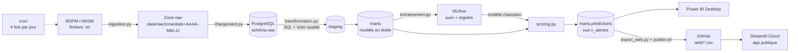
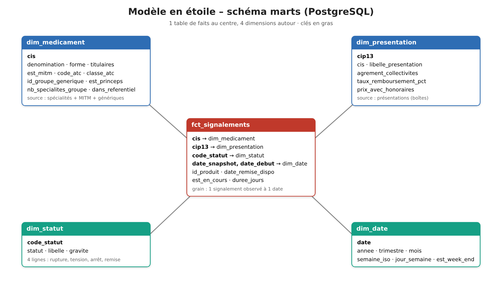
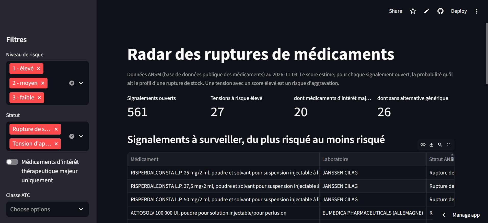
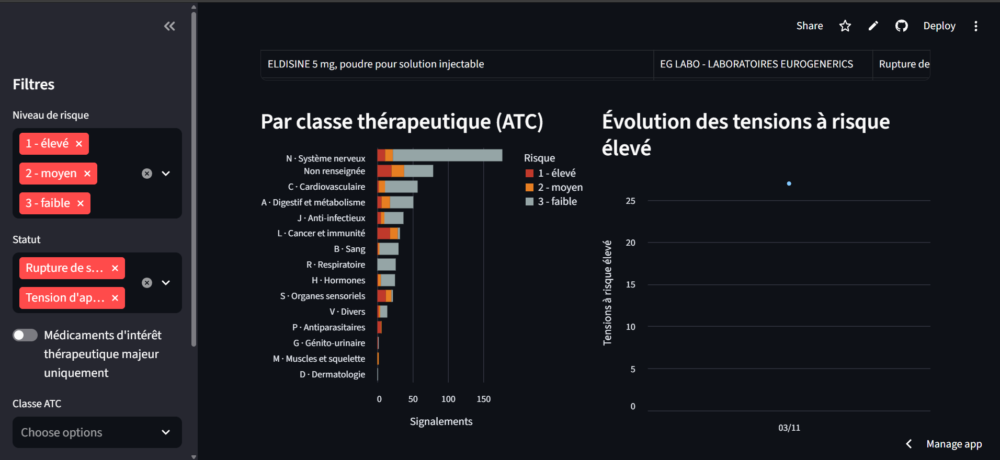
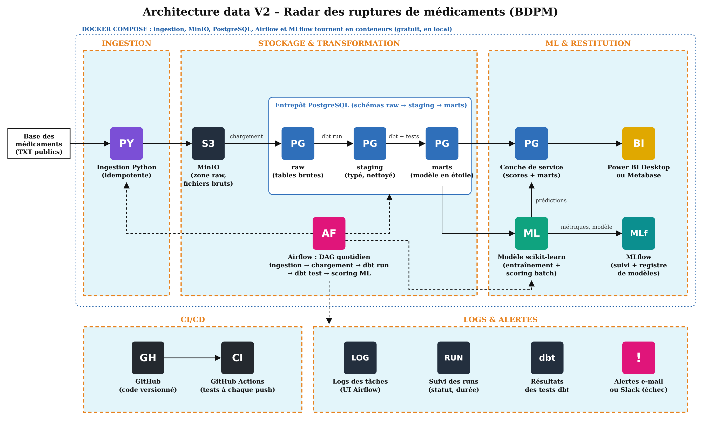
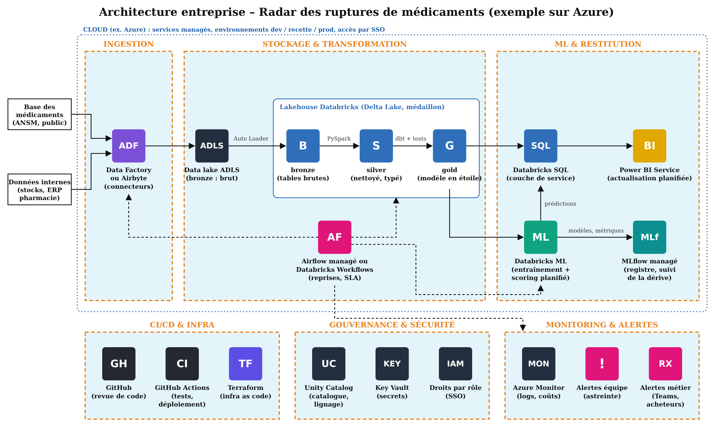

# Radar des ruptures de médicaments

Pipeline de données qui collecte chaque jour les signalements de tensions et de ruptures de médicaments publiés par l'ANSM, les transforme en modèle analytique testé, et entraîne un modèle de machine learning qui repère les **tensions d'approvisionnement qui ressemblent à des ruptures**. Le résultat alimente un tableau de bord pour un acheteur de pharmacie hospitalière.

Projet de certification **Data Lead – Jedha**.

**Tableau de bord en ligne :** https://radar-ruptures-medicaments-mb.streamlit.app

---

## 1. Le besoin métier

En pharmacie hospitalière, une rupture de stock se traduit par des patients sans traitement, des substitutions en urgence et des achats hors marché plus chers. L'ANSM publie la liste des médicaments en **tension** (stock fragile) et en **rupture**, mais cette liste ne dit pas quelles tensions risquent de s'aggraver.

**Question posée :** parmi les tensions en cours, lesquelles ont le profil d'une rupture et doivent être surveillées en priorité ?

**Utilisateur :** l'acheteur hospitalier, qui doit anticiper (commandes de sécurité, recherche d'alternatives).

## 2. Les données

Source : **Base de données publique des médicaments (BDPM)**, fichiers téléchargeables publiés par l'ANSM. Données publiques et mises à jour quotidiennement.

| Fichier | Contenu | Rôle dans le projet |
|---|---|---|
| `CIS_CIP_Dispo_Spec.txt` | Signalements de disponibilité (rupture, tension, arrêt, remise à disposition) | Table de faits |
| `CIS_bdpm.txt` | Spécialités (dénomination, forme, voie, titulaire…) | Dimension médicament |
| `CIS_CIP_bdpm.txt` | Présentations (boîtes, prix, remboursement, agrément collectivités) | Dimension présentation |
| `CIS_GENER_bdpm.txt` | Groupes génériques | Nombre d'alternatives |
| `CIS_MITM.txt` | Médicaments d'intérêt thérapeutique majeur | Criticité |

Le fichier des signalements ne donne que **l'état du jour**. L'historique est donc construit par le pipeline lui-même, grâce à une collecte datée quotidienne.

## 3. Architecture



Approche **ELT** : les fichiers sont chargés presque tels quels dans PostgreSQL, puis transformés en SQL dans la base.

| Étape | Outil | Ce qui est fait |
|---|---|---|
| Ingestion | Python (`requests`) | Téléchargement avec réessais, contrôle du contenu (page HTML, fichier vide), écriture atomique, métadonnées (taille, sha256, heure) |
| Zone raw | Fichiers datés | Copie brute, une partition par jour : `date=AAAA-MM-JJ` |
| Chargement | Python (`pandas`, `SQLAlchemy`) | Tout en texte dans le schéma `raw`, avec date du snapshot, fichier source et heure de chargement |
| Transformation | SQL dans PostgreSQL | Couches `staging` (nettoyage, typage) puis `marts` (modèle en étoile), un fichier SQL par table, à la manière de dbt |
| Qualité | Tests SQL | 17 tests (unicité, intégrité référentielle, fraîcheur, volumes, dates) |
| Machine learning | scikit-learn + MLflow | 3 modèles comparés, suivi des runs, registre de modèles avec alias `champion` |
| Restitution | Power BI Desktop, Streamlit | Tableau de bord local et app publique |
| Orchestration | cron | Pipeline à 9 h, 12 h, 15 h et 18 h ; publication web 20 min après |

### Pourquoi ces choix

- **Script Python plutôt qu'Airbyte** : la source est un fichier statique téléchargeable, pas une API ni une base. Un script de 150 lignes, testé, suffit ; un connecteur serait surdimensionné.
- **PostgreSQL** : base relationnelle standard, gratuite, qui sépare clairement les couches par schéma (`raw`, `staging`, `marts`) comme dans un entrepôt.
- **SQL organisé comme dbt** : un `SELECT` par fichier et des tests qui renvoient les lignes en défaut. Le passage à dbt en V2 se fera sans réécrire le SQL.
- **cron plutôt qu'Airflow** : quatre étapes en séquence, sur une seule machine. cron suffit pour la V1 ; Airflow est prévu en V2.

## 4. Idempotence

Chaque étape peut être relancée sans créer de doublon :

- **Ingestion** : un fichier déjà collecté pour la date du jour n'est pas retéléchargé (sauf `--force`). L'écriture passe par un fichier temporaire renommé, pour ne jamais laisser de fichier à moitié écrit.
- **Chargement** : pour un fichier et une date, suppression puis réinsertion dans une seule transaction.
- **Transformation** : chaque couche est reconstruite dans une seule transaction ; en cas d'erreur, la base reste dans son état précédent.
- **Scoring** : les prédictions du jour remplacent celles déjà présentes pour ce jour.

## 5. Modèle de données

Couche `marts`, modèle en étoile :

- **Faits** : `fct_signalements`, un signalement par présentation et par date de snapshot, avec statut, durée et indicateur « en cours ».
- **Dimensions** : `dim_medicament` (spécialité, MITM, générique, classe ATC), `dim_presentation` (boîte, prix, remboursement), `dim_statut`, `dim_date`.
- **Table ML** : `ml_signalements_ouverts`, une ligne par signalement ouvert avec ses variables explicatives.
- **Vue de service** : `v_alertes`, lue par Power BI et Streamlit.



## 6. Tests qualité

Les tests sont des requêtes SQL dans `sql/tests/` qui renvoient les lignes en défaut : 0 ligne signifie que le test est réussi. Chaque test déclare sa sévérité :

- `erreur` : le pipeline s'arrête en échec (code de sortie 1, visible dans les logs) ;
- `avertissement` : le problème est signalé, mais le pipeline continue.

Exemples : CIS unique dans les spécialités, statut parmi les valeurs connues, date de remise postérieure à la date de début, fraîcheur des données, volume minimal par snapshot, faits rattachés à une dimension existante.

Des tests Python (`pytest`) couvrent aussi l'ingestion, le chargement, les transformations et le ML, sur une base de test séparée.

## 7. Machine learning

**Cible actuelle :** pour un signalement ouvert, est-ce une rupture (1) ou une tension (0) ? Le modèle apprend le profil des ruptures. Appliqué aux tensions, un score élevé signale une tension qui ressemble à une rupture : c'est l'alerte pour l'acheteur.

**Variables :** ancienneté du signalement, classe ATC, forme et voie d'administration, médicament d'intérêt thérapeutique majeur, princeps ou générique, nombre de spécialités dans le groupe générique, nombre de présentations, taux de remboursement, prix moyen, agrément collectivités, surveillance renforcée, nombre de signalements du titulaire.

**Méthode :**

- 3 modèles comparés : régression logistique, forêt aléatoire, gradient boosting.
- Jeu de test de 25 % mis de côté, stratifié.
- Validation croisée à 5 plis sur le reste.
- Choix du modèle sur la **PR AUC**, adaptée aux classes déséquilibrées.
- Chaque essai est un run MLflow (paramètres, métriques, importance des variables, modèle). Le meilleur est enregistré dans le registre avec l'alias `champion`, que le scoring utilise.

**Résultats (snapshot du 3 novembre 2026) :**

| Modèle | PR AUC (validation croisée) | ROC AUC (test) | Rappel (test) |
|---|---|---|---|
| **Forêt aléatoire (champion)** | **0,587** | **0,936** | **0,62** |
| Gradient boosting | 0,523 | 0,920 | 0,81 |

Sur 561 signalements ouverts scorés, **27 tensions** dépassent 50 % de probabilité de rupture.

**Limite assumée :** le score dit « ce signalement a le profil d'une rupture », pas encore « cette tension deviendra une rupture dans 30 jours ». Cette cible, plus utile, demande plusieurs semaines d'historique quotidien. Le pipeline l'accumule : il suffira de changer la table et la cible dans `entrainement.py`, sans toucher au reste.

## 8. Restitution

**Power BI Desktop** (`powerbi/radar_ruptures.pbix`) : tensions à risque élevé, part des médicaments d'intérêt majeur, liste triée par risque avec code couleur, répartition par classe thérapeutique, évolution dans le temps, filtres. Un export PDF (`powerbi/radar_ruptures.pdf`) permet de consulter le tableau de bord sans Power BI.

**Streamlit** (`app/streamlit_app.py`) : la même lecture, accessible par un simple lien. L'app lit deux CSV publiés sur GitHub par `scripts/publier.sh`, et Streamlit Community Cloud la met à jour à chaque push.

Power BI répond à l'usage interne ; Streamlit permet une démonstration publique sans licence. Les deux lisent la même vue préparée en SQL : toute la logique reste dans le pipeline, versionnée et testée.





## 9. Installation et exécution

Prérequis : Python 3.10, PostgreSQL 12 ou plus, Linux ou WSL.

```bash
git clone git@github.com:Merylebazebi/radar-ruptures.git
cd radar-ruptures
python -m venv .venv && source .venv/bin/activate
pip install -r requirements.txt
cp .env.exemple .env      # puis renseigner DATABASE_URL et TEST_DATABASE_URL
```

Lancer le pipeline étape par étape :

```bash
python src/ingestion.py        # télécharge les fichiers du jour dans data/raw
python src/chargement.py       # charge le schéma raw
python src/transformation.py   # staging + marts + tests qualité
python src/entrainement.py     # entraîne et enregistre le modèle champion
python src/scoring.py          # prédictions + vue v_alertes
```

Ou en une fois, comme cron : `bash scripts/pipeline.sh` (logs dans `logs/pipeline.log`).

Autres commandes :

```bash
pytest                                              # tests Python
mlflow ui --backend-store-uri sqlite:///mlflow.db   # suivi des modèles, http://localhost:5000
streamlit run app/streamlit_app.py                  # app en local, http://localhost:8501
bash scripts/publier.sh                             # publie les données de l'app en ligne
```

Planification (`crontab -e`) :

```
0 9,12,15,18 * * *  bash /chemin/radar-ruptures/scripts/pipeline.sh
20 9,12,15,18 * * * bash /chemin/radar-ruptures/scripts/publier.sh >> /chemin/radar-ruptures/logs/publier.log 2>&1
```

## 10. Structure du dépôt

```
radar-ruptures/
├── src/              ingestion, chargement, transformation, entraînement, scoring, export web
├── sql/
│   ├── staging/      nettoyage et typage
│   ├── marts/        modèle en étoile et table ML
│   ├── service/      vue v_alertes pour les tableaux de bord
│   └── tests/        tests qualité SQL
├── tests/            tests Python (pytest)
├── scripts/          pipeline.sh (cron), publier.sh (app en ligne)
├── app/              app Streamlit
├── web/              CSV publiés pour l'app
├── powerbi/          tableau de bord Power BI
└── docs/             schémas
```

Les données (`data/`), les logs, le suivi MLflow et le fichier `.env` ne sont pas versionnés.

## 11. Évolutions : V2 et architecture d'entreprise

**V2 du projet :**

- **dbt** à la place de `transformation.py` (le SQL est déjà organisé pour) ;
- **Airflow** à la place de cron : dépendances entre tâches, reprise sur échec, alertes ;
- **Docker** pour rendre l'environnement reproductible ;
- **GitHub Actions** pour lancer les tests à chaque push ;
- passage à la **cible principale** (tension qui devient rupture dans les 30 jours) une fois l'historique suffisant.



**En entreprise**, la même logique s'appuierait sur des services gérés : stockage objet pour la zone raw, entrepôt cloud (Snowflake, BigQuery ou Databricks), dbt et Airflow managés, MLflow partagé, Power BI Service avec actualisation planifiée, et supervision centralisée. Croisée avec les données internes de l'hôpital (consommations, stocks, marchés), la prédiction deviendrait directement actionnable : stock de sécurité à constituer, alternative à référencer.



---

*Données : ANSM, Base de données publique des médicaments. Projet pédagogique, ne constitue pas un outil d'aide à la décision médicale.*
